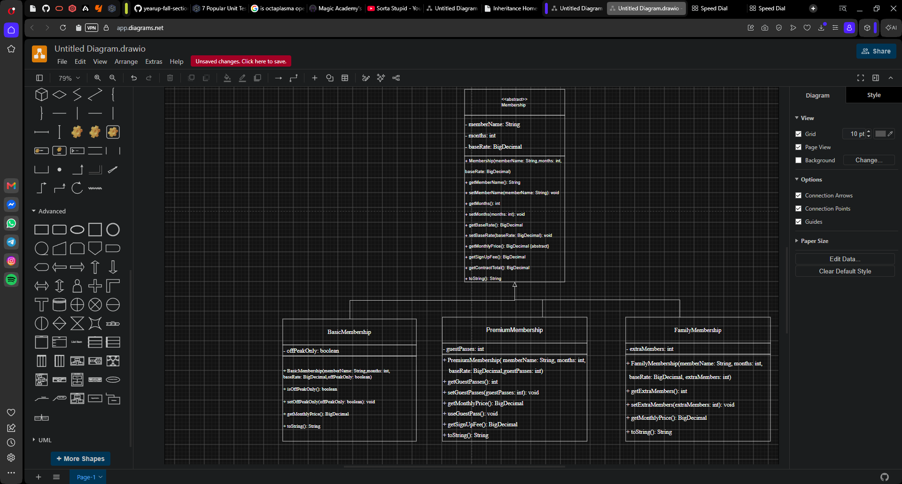

   # Gym Membership
A project that demonstrates inheritance, method overriding, polymorphism, abstract classes, and abstract methods

<!-- HOW TO USE THIS TEMPLATE
     Save it as README.md at the root of your project, next to pom.xml. Replace every comment like this one
     with your own text; comments do not show on GitHub, so what you leave untouched shows as an empty heading.
     Two sections are optional and say so: Class 

<!-- One sentence under the title: what the app is, for whom.
     Example: A console app that keeps a store's inventory in a csv file and lets a clerk search it. -->

## Description of the Project
Thisis about a gym that sells three kinds of memberships:

Basic membership — may be off peak only and receives a discount when applicable.

Premium membership — includes guest passes and receives a waived sign-up fee for contracts of 12 months or longer.

Family membership — charges extra for additional family members and applies a discount when there are at least three extra members.

it calculates each member's monthly price, sign up fee, and contract . 
It also demonstrates front desk work like using guest passes, printing keycard counts.


## Features
* Calculates sign up fees and complete contract.
* Uses BigDecimal for all price values and calculations.
* Demonstrates inheritance and method overriding.
* Manages premium guest passes and displays remaining passes.
* Calculates the number of family key cards required.
* Includes a UML class diagram showing the relationships between the membership classes.


## Setup

### Prerequisites

- Java 17 (Amazon Corretto), the version used in class.
- IntelliJ IDEA Community Edition: <https://www.jetbrains.com/idea/download/>

### Running the application

1. Clone this repository, or download it as a zip and unzip it.
2. In IntelliJ: File > Open, pick the project folder (the one that holds `pom.xml`), press Open.
3. Wait for IntelliJ to finish indexing (progress bar at the bottom).
4. Open `src/main/java/com/pluralsight/YourMainClassName.java`. <!-- replace YourMainClassName with the class that has main -->
5. Right-click inside the file and choose Run 'YourMainClassName.main()'.
     
## Technologies Used

- Java 17
- IntelliJ IDEA
<!-- Add anything else you used: a library, Maven plugins, an external tool. For a console app this list is short. That is fine. -->

## Demo

<!-- Pictures of the app running: the console for a console app, Insomnia or Swagger for an API.
     Screenshots are enough; a GIF is a bonus.
     1. Create a folder named `images` at the project root, next to `pom.xml`.
     2. Take screenshots of the app in the IntelliJ console (the menu, one feature, one error message):
          Windows: Win + Shift + S, drag a rectangle, then paste into Paint and save as PNG, or open the
                   notification and save. Save into the `images` folder.
          Mac:     Shift + Cmd + 4, drag a rectangle. The file lands on the Desktop; move it into `images`.
     3. Name the files by what they show: `images/menu.png`, `images/search.png`.
     4. Reference each one below with a relative path. No spaces in file names.
     5. Commit the images with the rest of your work (Git > Commit shows them as unversioned files: tick them).
     Optional GIF: LICEcap (free, Windows and Mac, <https://www.cockos.com/licecap/>) records a region of the
     screen straight to a .gif. Keep it under 10 seconds and under 10 MB, save it into `images`. -->




```java

```

## Future Work

<!-- What you would add or fix next, one bullet each. Unfinished bonuses belong here. -->


## Resources

<!-- What helped you: the workbook, the week's hub pages, a tutorial, a documentation page. Real links. -->

- Java YearUp Fall 2026 hub: <https://raymaroun.github.io/yearup-java-fall2026/>


## Author

Nahom Hagos


## Thanks
Raymond for making the steps on the project 
